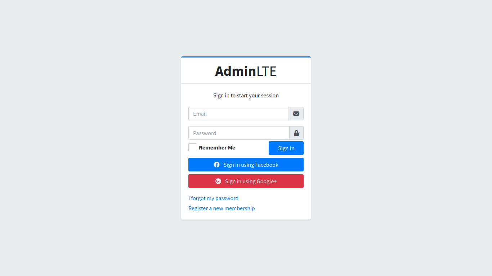
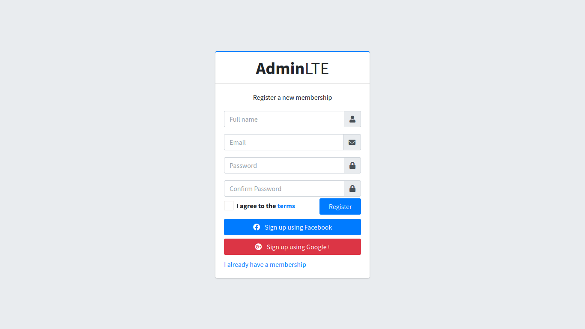
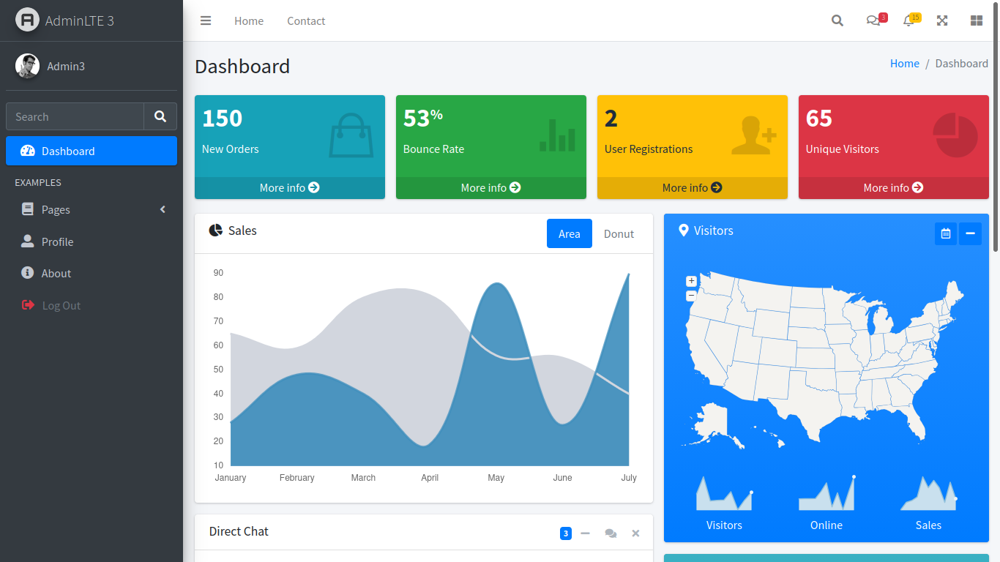
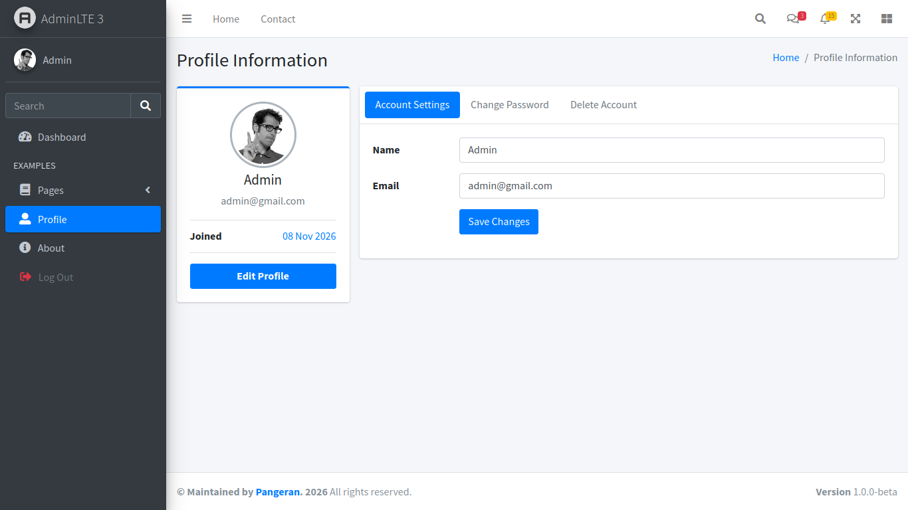
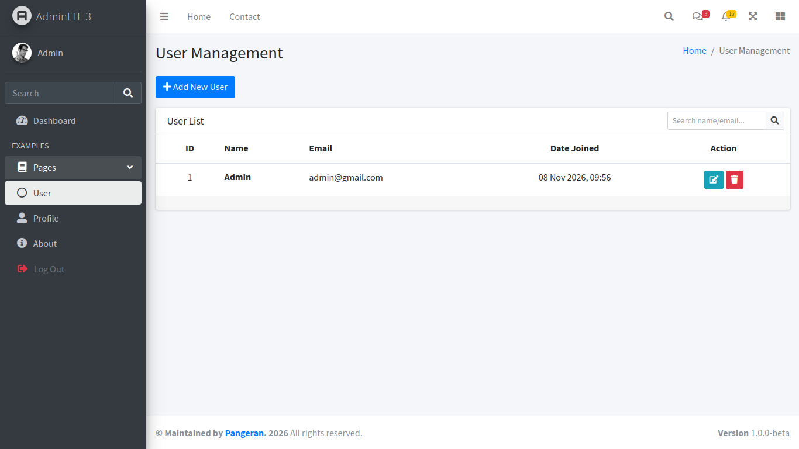
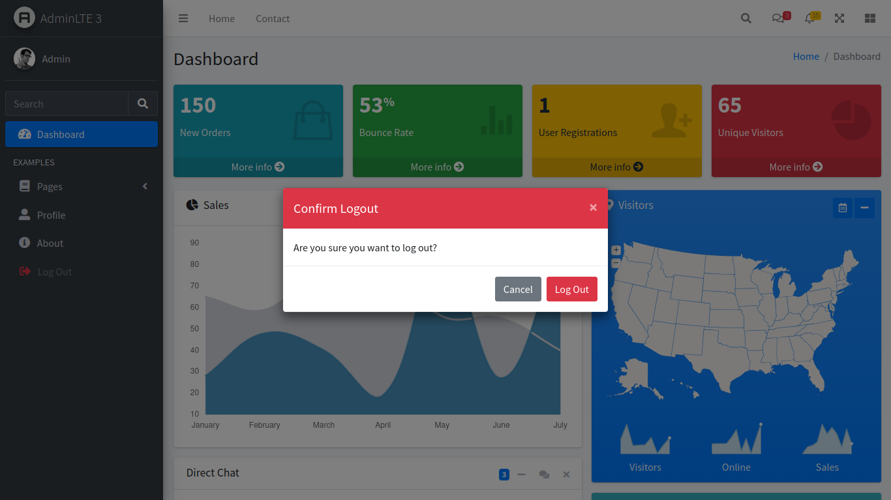

<p align="center"><a href="https://laravel.com" target="_blank"></a></p>

<p align="center">
<a href="https://github.com/pangeran-droid/laravel-admin-lte-3"></a>
<a href="https://github.com/pangeran-droid/laravel-admin-lte-3/forks"></a>
<a href="https://github.com/pangeran-droid/laravel-admin-lte-3/issues"></a>
<a href="https://github.com/pangeran-droid/laravel-admin-lte-3/blob/main/LICENSE"></a>
</p>

<p align="center">


</p>

<h1 align="center">Laravel AdminLTE 3</h1>

<p align="center">
A Laravel starter application integrated with <a href="https://adminlte.io">AdminLTE 3</a>. It includes authentication, a dashboard, profile pages, and user management, with FrankenPHP support for local development and Docker or Podman containers.
</p>

| Laravel Version | Branch |
|-----------------|--------|
| 13.x            | main   |

## Requirements

For local development:

- PHP 8.3 or later and Composer
- Node.js and npm
- A database supported by Laravel and configured in `.env`
- FrankenPHP to run the included Octane development script

For containerized development:

- Docker with the Compose plugin, or Podman with a Compose provider
- A database server configured in `.env` (the included container does not start a database)

## Getting started

Clone the repository and enter its directory:

```bash
git clone https://github.com/pangeran-droid/laravel-admin-lte-3.git
cd laravel-admin-lte-3
```

Create your environment file and configure the database connection:

```bash
cp .env.example .env
```

The example environment uses MySQL. Make sure a MySQL server is available and update the database settings in `.env` before migrating.

### Local development

Install dependencies, generate the application key, migrate the database, and build the frontend assets:

```bash
composer install
php artisan key:generate
php artisan migrate
npm install
npm run build
```

Start the application with FrankenPHP and Laravel Octane:

```bash
bash scripts/dev.sh
```

The app is available at [http://localhost:8000](http://localhost:8000). The script expects FrankenPHP to be installed on the host.

Alternatively, start Laravel's built-in development server:

```bash
php artisan serve
```

### Docker Compose

The included `docker-compose.yaml` builds and runs the app with FrankenPHP. It uses host networking, so the app is available on port `8000` and the database host in `.env` must be reachable from the host network.

```bash
docker compose run --build --rm app php artisan key:generate
docker compose up -d
docker compose exec app php artisan migrate --force
```

Open [http://localhost:8000](http://localhost:8000). To view logs or stop the app:

```bash
docker compose logs -f app
docker compose down
```

### Podman

You can use the Compose file with Podman if a Compose provider is installed:

```bash
podman compose run --build --rm app php artisan key:generate
podman compose up -d
podman exec -it laravel-admin-lte-3 php artisan migrate --force
```

Or use the included helper script from the project root:

```bash
bash scripts/run.sh
podman exec -it laravel-admin-lte-3 php artisan migrate --force
```

The helper script stops and removes any existing container named `laravel-admin-lte-3` before rebuilding and starting it. The container uses host networking and listens on port `8000`.

## Credits & technology

- [Laravel](https://laravel.com) - PHP application framework.
- [AdminLTE 3](https://adminlte.io) - Bootstrap-based admin dashboard template.
- [Bootstrap 4](https://getbootstrap.com) - Responsive CSS framework.
- [Font Awesome](https://fontawesome.com) - Icon toolkit.
- [FrankenPHP](https://frankenphp.dev) - PHP application server.
- [Docker](https://www.docker.com) and [Podman](https://podman.io) - Container engines.

## Preview

`login`



***

`register`



***

`dashboard`



***

`profile`



***

`user management`



***

`logout`



## License

Licensed under the [MIT](LICENSE) license.
